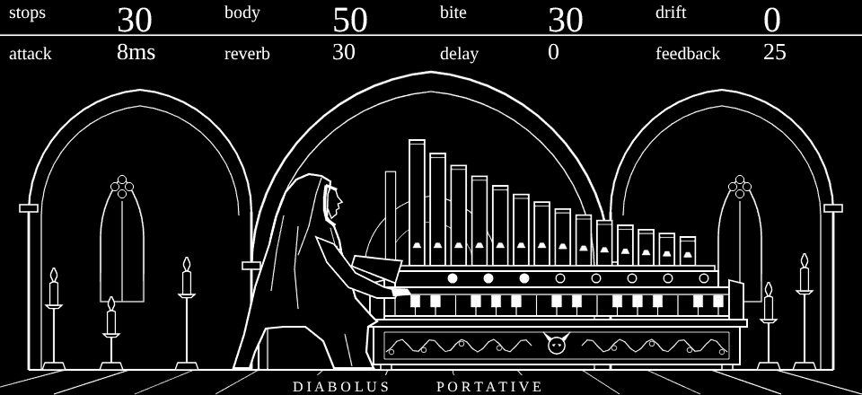

# Diabolus Portative

A sample-free medieval portative pipe organ for the Teenage Engineering OP-XY,
built as an [Open-XY](https://github.com/etcetc000/open-xy) machine (ID `diabolus`).
Every sound is synthesized as it plays: flue pipe ranks, the breath at the
pipe mouth, wind that wavers, and a cathedral reverb and tape-dark delay of its own.



**Hear it:** [a witch house tour of all twelve presets](docs/diabolus-witch-house.mp4)
(2:25). The organ is this machine's own code rendered offline, with the OP-XY's
amp envelope and tremolo emulated; the sub bass and drums were added for the song.

**Try it:** [install guide](INSTALL.md), with a browser installer page, no command line.

Diabolus Portative was inspired by an idea from Franny on the Custom Operator
Discord server. Thank you for the spark that became this instrument.

Image updates by DWD.

## Controls

Two pages of four. Press any encoder to switch pages.

| Page | Control | What it does |
| --- | --- | --- |
| 1 | **STOPS** | Draws the ranks, one at a time: 8' alone, then 4', 2 2/3', 2', 1 3/5', 1 1/3', 1 1/7' and 1'. The knobs on the wind chest light as each rank speaks. |
| 1 | **BODY** | From a hollow, flute-like pipe to a full principal with a 16' rank underneath. |
| 1 | **BITE** | From soft to bright and nasal: lifts the upper partials and the reed-like odd ones, and sharpens the chiff. |
| 1 | **DRIFT** | Wind and tuning life: slow beating between ranks and up to 3 cents of wind-pressure wander. At zero the organ is perfectly steady. |
| 2 | **ATTACK** | How fast the pipes speak, 3 ms to 1.5 s. Upper ranks speak a little before the foundation, as on a real organ. Fast attacks carry a breath of chiff. |
| 2 | **REVERB** | A stone room inside the machine, from a chapel (2.2 s) to a cathedral (6.5 s). |
| 2 | **DELAY** | A dark 320 ms echo, also inside the machine. |
| 2 | **FEEDBACK** | How long the echo repeats, 0 to 85 percent. A limiter in the loop keeps it from running away. |

The reverb and delay are part of the machine's own sound. They are not the
OP-XY's global effects, which stay free for anything else.

## Presets

Twelve factory presets. Four of them (Black Cantor, Unlit, Endless and Last
Office) come with the OP-XY's stock tremolo LFO switched on at its stock
settings, for a tremulant.

| Preset | Character |
| --- | --- |
| Vespers | The default: a quiet flue chorus in a chapel. |
| Devils March | Full, bright and close, with an echo that marches. |
| Ashen | A lone hollow flute dissolving into a huge room. |
| Black Cantor | Nasal and reedy, singing through dark repeats. Tremulant. |
| Reliquary | A single full principal, still and sacred. |
| Unlit | Slow-speaking pipes in the dark. Tremulant. |
| Adversary | Many ranks, bitter and out of tune. |
| Midnight | A balanced chorus with a long echo. |
| Endless | Every rank, in an endless room. Tremulant. |
| Hollow Saint | Hollow ranks, half-lit. |
| Last Office | A swell from nothing into deep repeats. Tremulant. |
| Diabolus | The full organ, bright and unsteady, in a large room. |

## The screen

White line art on black, with no grey: a nun at a portative organ under three
Gothic arches, with candles on iron prickets in the side bays. The header shows
the four controls of the current page with their values in real units.
While notes are held, breath rises from the pipes, and the nun and the candles
leave their places to float and sway; they settle back when you let go.
With reduced motion on, nothing floats.

Every control shows on the screen, following the Open-XY screen guidelines:

| Control | On the screen |
| --- | --- |
| STOPS | The stop knobs on the wind chest light, one per rank drawn |
| BODY | A 16' bourdon pipe rises behind the bass pipes |
| BITE | The horns on the case's mask grow |
| DRIFT | The candles lean, and sway further while you play |
| ATTACK | The bellows stand open for instant speech and close as speech slows |
| REVERB | Arcs open out to fill the vault |
| DELAY | Echoes leave the treble pipes |
| FEEDBACK | More echoes follow |

## How it works

- **Pipes.** One cosine at the 16' pitch builds all nine partials through
  double-angle products, so every rank stays exactly in tune with the others.
  STOPS, BODY and BITE set the partial weights, which ramp every eight samples
  so control moves never click. The total is normalized so a full registration
  is no louder than a single rank.
- **Speech.** The attack envelope is folded into the partial weights, upper
  partials leading. The chiff is a difference of two decays applied to filtered
  noise.
- **Room.** The effects run at an eighth of the sample rate (5.5 kHz) after an
  anti-alias filter, which is all a dark stone room needs. The delay is 320 ms
  with damping and a level follower in its loop. The reverb is a four-line
  Hadamard feedback network with two allpass diffusers, damped at 1.5 kHz.
  The wet signal is interpolated back to 44.1 kHz and a soft-knee limiter
  keeps the output within its declared peak.
- **Voices.** Up to eight voices. Each voice carries its own reverb and delay
  (7,240 bytes per voice), because the SDK gives synths no shared bus.
  Fixed-point integer code only: no floating point and no division in the
  audio path.

## What has been tested

Measured on a computer (`tests/`, run by `sdk.py test`):

- Pitch purity, each control's effect on the spectrum, attack timing, the
  reverb and delay tails, and the stability of maximum feedback.
- All twelve presets audible and distinct, an eight-voice chord with steals and
  pitch bends, no DC.
- No clicks when any control jumps from end to end on a held note, a smooth
  onset from silence at every attack, smooth fast bends, and no dropouts in a
  two-minute drone.
- Hostile input: every control word including negative and full scale, wild
  pitches, stale voice memory, and twenty thousand random blocks.
- The screen: every frame valid under random input, captions that fit
  their column, every control changing the drawing at 0, 50 and 100, the
  redraw budget (18 changed nodes a frame on average while playing, none at
  rest), the floating figures settling exactly back, and reduced motion.
- The native Blackfin module compiles with the official toolchain:
  153.0 of 2032 KiB of module memory (Diabolus 85.9 KiB, SDK 67.0 KiB).

Not yet measured: the CPU cost on an OP-XY. The SDK's host-timed estimate is
only a guide and swings widely between runs on a busy computer: it read about
11,000 to 14,400 Blackfin instructions per voice block on quiet runs and up to
about 23,000 on noisy ones, against an aim of 15,000. A hardware profiling run
is the real answer. Until one is done, treat eight-voice chords with every
control at full as untested on the device.

## Try it

**Install without the command line:** download the [installer page](https://github.com/SammiBabe666/Diabolus-Portative/raw/main/install/Diabolus-Portative-installer.html),
open it in Chrome, and follow [INSTALL.md](INSTALL.md). You can also play the
organ on that page before installing anything.

## Install on an OP-XY (at your own risk)

Open-XY replaces the OP-XY's firmware with a development build. That carries
real risk. Before you start:

- Back up your projects, samples and presets from the OP-XY to your computer.
- Keep a copy of the stock firmware you can reinstall, and read the SDK's
  [build guide](https://github.com/etcetc000/open-xy/blob/staging/docs/build.md)
  to learn how to restore it before you install anything.
- This build was tested against OP-XY OS 1.2.1 only. Other OS versions are not
  supported.

Firmware, stock content and any package containing them are never committed to
this repository.

## Build

With the SDK checked out beside this repository as `../open-xy`
(built and tested at commit `892ad936`):

```sh
python ../open-xy/sdk.py test --machine . --host-cxx g++
python ../open-xy/sdk.py preview --machine . --out ../previews/diabolus-001
python ../open-xy/tools/serve_harness.py --preview ../previews/diabolus-001
python ../open-xy/sdk.py compile --machine . --out ../builds/diabolus-module
```

The presets, `definition.json` parameters and `tests/presets.h` are generated by
`python generators/presets.py .`; the screen art by `python generators/panel.py .`.

## More

The [final report](docs/REPORT.md) covers the architecture, what is measured and what is pending.
[tools/media](tools/media) shows how the GIF and video were made, and [docs/artwork](docs/artwork) holds the artwork drafts.

## License

MIT. See [LICENSE](LICENSE).
